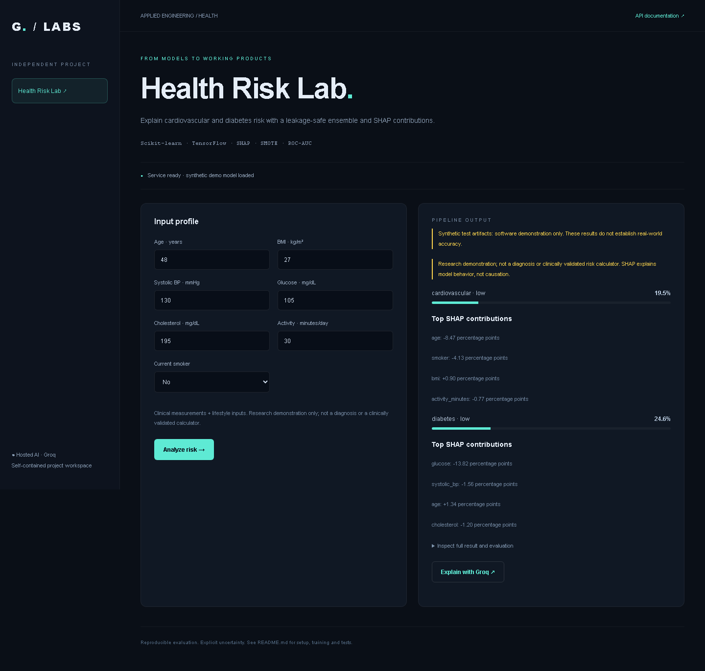
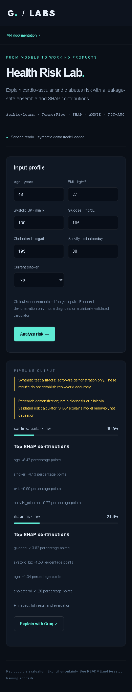

# Multimodal AI Health Risk Prediction Suite

[](https://github.com/morpheus-3/multimodal-ai-health-risk-suite/actions/workflows/tests.yml)

## Screenshots



<details>
<summary>Mobile view</summary>



</details>


Independent runnable project in `multimodal-ai-health-risk-suite`. Includes a browser UI, REST API, training command, artifact persistence and automated tests. Open the UI at **http://127.0.0.1:8011** and API docs at `/docs`.

## Install and start

Run from this folder (Python 3.10):

```powershell
py -3.10 -m venv .venv
.\.venv\Scripts\python -m pip install -r requirements.txt
$env:GROQ_API_KEY = '<your Groq API key>'
.\.venv\Scripts\python -m uvicorn projects.api:app --host 127.0.0.1 --port 8011
```

Groq is the only hosted AI provider. Optional explanations call its chat completions API, using `GROQ_MODEL` (default `llama-3.3-70b-versatile`). The requested Scikit-learn/TensorFlow/PyTorch models train and run locally; Groq cannot execute arbitrary custom model weights. Missing keys fail explicitly; no other provider is used. The explanation button sends the displayed model result to Groq, not the uploaded image. Set credentials in the server environment, never source code. The UI keeps inputs in page memory.

## Dataset and training


CSV columns: `age,bmi,systolic_bp,glucose,cholesterol,smoker,activity_minutes,cardiovascular,diabetes`. Targets are 0/1; smoker is 0/1; age is years, BMI kg/m², BP mmHg, glucose and cholesterol mg/dL, activity minutes/day. Requires 60+ complete rows and at least ten examples of each target class. Use representative, consented, de-identified data. Clinical measurements and lifestyle data are separate input groups; this implementation does not analyze medical images or free-text records.

```powershell
.\.venv\Scripts\python -m projects.train path/to/health.csv --epochs 20
```

The pipeline splits before scaling and SMOTE, then averages logistic regression, random forest and TensorFlow MLP probabilities. Reports held-out ROC-AUC and Brier loss per target. Kernel SHAP explains that same ensemble, with a stored training-only background. Low/moderate/high cutoffs (0.4/0.7) are illustrative, not clinical thresholds. Not a medical device, diagnosis or validated clinical calculator. SHAP values describe model behavior, not causal effects.


## Test

```powershell
.\.venv\Scripts\python -m pytest tests -q
```

Tests train on deterministic synthetic fixtures, reload artifacts and exercise inference, validation and Groq request contracts. Synthetic metrics establish software execution only, not real predictive quality. Live Groq inference requires a valid key and quota and is not part of automated tests.

## Optional labeled demo data

```powershell
.\.venv\Scripts\python -m projects.fixtures projects/artifacts/fixtures
.\.venv\Scripts\python -m projects.train projects/artifacts/fixtures/health.csv --epochs 2 --synthetic
```

Restart the service after training. Artifacts live in `projects/artifacts`, or `PROJECT_ARTIFACTS` if configured. Replace synthetic artifacts with models trained on appropriate real data before reporting quality. No real training dataset was supplied.
